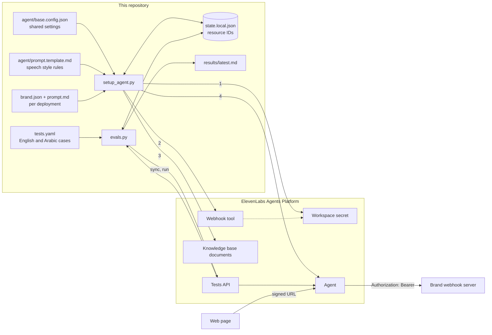

# bilingual-voice-agent

Configure an English and Arabic ElevenLabs voice agent from a JSON file, and check it with a repeatable test suite.

Status: code and mocked tests complete. The live evaluation has not run yet (see [Results](#results)).

## The problem

A voice agent for a real business has to do four things before anyone should trust it in front of customers:

1. Answer from the business's own documents, not from what the model happens to know.
2. Call the business's own systems (here, a webhook) with the right parameters.
3. Work in more than one language. This project targets English and Arabic, including callers who use Gulf dialect.
4. Prove all of that with tests that can be rerun after every prompt or model change.

Setting this up by hand in a dashboard is quick once and slow every time after: settings drift, nobody can review a change, and there is no record of whether the agent got better or worse. This project keeps the whole agent in version control and runs the same checks each time.

## Architecture



## How it works

**Configuration as code.** `agent/base.config.json` holds the settings every deployment shares: models, limits, privacy, guardrails, evaluation criteria and data collection fields, with `{{placeholders}}` for anything brand specific. A brand file (see `examples/brand.example.json`) supplies names, first messages, voice IDs, knowledge base URLs and webhook tools. `config.py` validates both files with pydantic and merges them into the exact request bodies ElevenLabs expects.

**Idempotent setup.** `setup_agent.py` runs four steps in order: workspace secret, webhook tool, knowledge base documents, agent. Every ID it receives goes into `state.local.json`. A second run reads that file and updates the same resources (`PATCH`) instead of creating new ones. Resources dropped from the brand file are deleted on the next run. `--teardown` deletes everything the state file lists.

**Dry run by default.** Without `--apply`, nothing is sent. The script prints every request it would make, as JSON, with secret values masked. `--apply` refuses to run while a voice ID is still a placeholder.

**Bilingual set-up.** The agent's default language is English. Arabic is a language preset with its own first message and its own voice (`language_presets.ar.overrides.tts.voice_id`). The `language_detection` system tool lets the agent switch mid-call, and the web page can also pass the caller's chosen language at the start (`overrides.agent.language`, the only overrides enabled besides the first message).

**Webhook authentication.** ElevenLabs stores the tool secret as a workspace secret and the tool references it by `secret_id` in `request_headers`. A header value is either plain text or a secret reference; it cannot join the two. So the stored secret is the whole header value, `Bearer <token>`, and the server receives `Authorization: Bearer <token>`.

**Evaluation with the Tests API.** `evals.py sync` turns each YAML case into an ElevenLabs test: `llm` tests judge a reply against a success condition with passing and failing examples; `tool` tests check that the agent called the webhook with the expected parameters; `simulation` tests run a short simulated call against a caller persona. `evals.py run` starts all tests in one invocation, polls until they finish, and writes a table by language and test type. The older simulate-conversation endpoint is deprecated, so it is not used.

**Results retrieval.** After `POST /v1/convai/agents/{agent_id}/run-tests`, results are read from `GET /v1/convai/test-invocations/{test_invocation_id}`, found in the official Python SDK (`conversational_ai.tests.invocations.get`). Listing the agent's conversations was not needed.

**Agent settings** (from `agent/base.config.json`):

| Area | Setting |
| --- | --- |
| LLM | `claude-haiku-4-5` (a brand file can override it) |
| Speech to text | `asr.provider: scribe_realtime` |
| Text to speech | `tts.model_id: eleven_flash_v2_5` (supports Arabic) |
| Knowledge base | URL documents, `usage_mode: auto`, RAG on |
| System tools | `end_call`, `language_detection` |
| Limits | 300 second calls, 40 calls a day, 2 at once, no bursting |
| Access | signed URL only (`auth.enable_auth: true`) |
| Privacy | `record_voice: false`, 30 day retention |
| Guardrails | focus and prompt injection on |
| Evaluation criteria | answered from documents, stayed in scope, replied in the caller's language, no invented figures, offered a next step |
| Data collection | topic, language, whether a tool was used; no names, emails or salaries |

## Endpoints used

Every path and body was checked against the official `elevenlabs` Python SDK (version 2.76.0), in `elevenlabs/conversational_ai/**/raw_client.py` and `elevenlabs/types/`.

| Step | Method and path | Docs |
| --- | --- | --- |
| Create secret | `POST /v1/convai/secrets` | [secrets: create](https://elevenlabs.io/docs/eleven-agents/api-reference/workspace/secrets/create) |
| Update secret | `PATCH /v1/convai/secrets/{secret_id}` | [secrets: update](https://elevenlabs.io/docs/eleven-agents/api-reference/workspace/secrets/update) |
| Delete secret | `DELETE /v1/convai/secrets/{secret_id}` | [secrets: delete](https://elevenlabs.io/docs/eleven-agents/api-reference/workspace/secrets/delete) |
| Create tool | `POST /v1/convai/tools` | [tools: create](https://elevenlabs.io/docs/api-reference/tools/create) |
| Update tool | `PATCH /v1/convai/tools/{tool_id}` | [tools: update](https://elevenlabs.io/docs/api-reference/tools/update) |
| Delete tool | `DELETE /v1/convai/tools/{tool_id}` | [tools: delete](https://elevenlabs.io/docs/api-reference/tools/delete) |
| Add document from URL | `POST /v1/convai/knowledge-base/url` | [knowledge base: create from URL](https://elevenlabs.io/docs/api-reference/knowledge-base/create-from-url) |
| Delete document | `DELETE /v1/convai/knowledge-base/{documentation_id}` | [knowledge base: delete](https://elevenlabs.io/docs/api-reference/knowledge-base/delete) |
| Create agent | `POST /v1/convai/agents/create` | [agents: create](https://elevenlabs.io/docs/api-reference/agents/create) |
| Update agent | `PATCH /v1/convai/agents/{agent_id}` | [agents: update](https://elevenlabs.io/docs/api-reference/agents/update) |
| Delete agent | `DELETE /v1/convai/agents/{agent_id}` | [agents: delete](https://elevenlabs.io/docs/api-reference/agents/delete) |
| Signed URL (for the web page) | `GET /v1/convai/conversation/get-signed-url?agent_id=` | [authentication](https://elevenlabs.io/docs/eleven-agents/customization/authentication) |
| Create test | `POST /v1/convai/agent-testing/create` | [tests: create](https://elevenlabs.io/docs/api-reference/tests/create) |
| Update test | `PUT /v1/convai/agent-testing/{test_id}` | [tests: update](https://elevenlabs.io/docs/api-reference/tests/update) |
| Delete test | `DELETE /v1/convai/agent-testing/{test_id}` | [tests: delete](https://elevenlabs.io/docs/api-reference/tests/delete) |
| Run tests | `POST /v1/convai/agents/{agent_id}/run-tests` | [tests: run](https://elevenlabs.io/docs/api-reference/tests/run-tests) |
| Get results | `GET /v1/convai/test-invocations/{test_invocation_id}` | [test invocations: get](https://elevenlabs.io/docs/api-reference/tests/test-invocations/get) |

All calls go to `https://api.elevenlabs.io` with the `xi-api-key` header. The client retries on HTTP 429 and 5xx with exponential backoff (and honours `Retry-After`), and never prints the key.

## Results

The live evaluation runs on a desktop machine with a real API key, because the development environment for this repository cannot reach `api.elevenlabs.io`. `results/latest.md` is written by that run. **There has been no live run yet**, so the table there is empty.

## Demo

`docs/demo.gif` (to be added after the live run): one English call and one Arabic call.

## How to run

Requires Python 3.11 or later.

```bash
python -m venv .venv && source .venv/bin/activate
pip install -e ".[dev]"
cp .env.example .env            # then fill in the values

# 1. Dry run: prints every request as JSON, sends nothing.
python -m voice_agent.setup_agent --brand examples/brand.example.json

# 2. Put real voice IDs in your brand file, then create or update the agent.
python -m voice_agent.setup_agent --brand path/to/brand.json --apply

# 3. Create or update the tests, then run them.
python -m voice_agent.evals sync --brand path/to/brand.json --tests path/to/tests.yaml
python -m voice_agent.evals run  --brand path/to/brand.json --tests path/to/tests.yaml \
    --sanitise "Your Brand=>the relocation platform"

# 4. Remove everything this state file created.
python -m voice_agent.setup_agent --teardown
```

`--sanitise "FIND=>REPLACE"` (repeatable, case insensitive) rewrites brand names in `results/latest.md` and the raw JSON, so results can be published without naming the client. Raw JSON goes to `results/raw/`, which git ignores.

Run the checks:

```bash
pytest
ruff check .
```

The test suite mocks every HTTP call with `respx`; it never touches the network.

### Brand file

See `examples/brand.example.json` (a fictional company, Northwind Relocation, with `example.com` URLs). Paths inside it are relative to the brand file. `voice_id` may be `VOICE_ID_EN` or `VOICE_ID_AR` while you are drafting; the dry run warns and `--apply` refuses. `llm: null` keeps the base config's model. Each webhook tool's `body_schema` is a small JSON schema (`string`, `number`, `integer`, `boolean`, with `description`, optional `enum` for strings, and a `required` list) that is converted to ElevenLabs' `request_body_schema`.

### Tests file

See `examples/tests.example.yaml`. Each case has an `id` that starts with its language (`en-...`, `ar-...`), a `type` of `llm`, `tool` or `simulation`, and an optional `dialect` (`msa` or `gulf`) for Arabic. Chat history turns use the roles `user` and `agent`, and the last turn must be the user's. Tool parameters are exact matches by default; use `{regex: ...}`, `{llm: ...}` or `{anything: true}` for looser checks.

## What I learned

<!-- CONFIRM: written after the live run -->
- (to be written after the live run)

<!-- CONFIRM: written after the live run -->
- (to be written after the live run)

<!-- CONFIRM: written after the live run -->
- (to be written after the live run)

## Limitations

- **Gulf dialect accuracy is undocumented.** ElevenLabs rates Scribe's Arabic speech recognition in its "Good" band (word error rate above 10% and up to 20%) with no dialect breakdown. The test set includes Gulf-dialect phrasing so the gap shows up in results rather than being assumed away.
- **Per-language voice.** The SDK types allow `tts.voice_id` inside a language preset's overrides, which this project uses. The public docs do not describe it. If the API ignores it, set the Arabic voice in the dashboard (agent, Voice, per language) and note it here.
- **Language switching mid-call.** ElevenLabs' own pages disagree on whether the language can change after a call starts. The agent has the `language_detection` tool, and the web page also sets the language up front.
- **Tests run against the default language.** All tests run in one invocation against the agent as configured, so Arabic cases test a caller who speaks Arabic to an agent whose default language is English. That matches a caller who switches, not one who picked Arabic on the page first.
- **Tool parameter paths.** Tool tests use the bare property name (for example `bedrooms`) as the parameter path. The SDK does not document the path format; `evals sync --param-path-prefix` changes it if the live API expects a prefix.
- **Knowledge base documents are not refreshed.** A URL already in the state file is reused as is. Delete its entry from the state file (or run `--teardown`) to fetch it again.
- **Docs links.** The endpoint paths above come from the SDK source. Some docs page links follow ElevenLabs' URL pattern and were not opened from the development environment.

## Licence

MIT. See [LICENSE](LICENSE).
